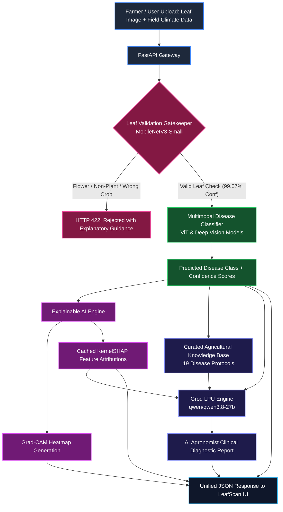

<div align="center">

# 🌿 FruitGuard AI • LeafScan
### **Multimodal Fruit Disease Diagnosis with Explainable AI & AI Agronomist Guidance**

[](https://python.org)
[](https://pytorch.org)
[](https://fastapi.tiangolo.com)
[](https://react.dev)
[](https://vitejs.dev)
[](https://groq.com)
[](https://opensource.org/licenses/MIT)

<br/>

**FruitGuard AI** is an end-to-end, clinical-grade precision agriculture diagnostic suite. It combines deep vision models (Vision Transformers & CNNs) with ambient microclimate environmental factors (temperature, relative humidity, rainfall, soil moisture, and pH) to accurately identify foliar diseases across **Mango, Apple, and Banana** orchards with full transparency.

[Key Features](#-key-features) • [System Architecture](#-system-architecture) • [Disease Taxonomy](#-supported-crops--disease-taxonomy) • [Quick Start](#-quick-start) • [API Reference](#-api-endpoints) • [Explainability (XAI)](#-explainable-ai-xai)

---

</div>

<br/>

## 🌟 Key Features

| Capability | Technical Implementation | Practical Benefit |
| :--- | :--- | :--- |
| 🛡️ **Intelligent Leaf Gatekeeper** | Custom **MobileNetV3-Small** 5-class validator (99.07% accuracy) | Rejects flowers, weeds, wrong fruits, and non-plant photos **before** inference with HTTP 422—preventing hallucinated diagnoses. |
| 🧬 **Multimodal Fusion Engine** | **Vision Transformer (ViT)** + Environmental MLP Heads | Fuses leaf symptom imagery with continuous environmental sensor data (temperature, humidity, rainfall, soil moisture, soil pH, season). |
| 🔍 **Visual Attention Maps (Grad-CAM)** | High-resolution convolutional gradient activation maps | Visualizes exact lesion boundaries, chlorotic halos, and fungal spore clusters for farmer and agronomist verification. |
| 📊 **Climatic Feature Impact (KernelSHAP)** | Token-cached perturbation explainer (~1.8s execution) | Quantifies exact environmental disease drivers (e.g., +28% disease probability from 92% sustained humidity). |
| 🤖 **AI Agronomist Diagnostic Reports** | **Groq LPU Engine** (`qwen/qwen3.8-27b`) + Curated KB | Generates natural-language clinical reports with organic remedies, chemical protocols, harvest safety intervals, and cultural sanitation. |
| ⚡ **Modern LeafScan UI** | React 19 + Lucide + Vite with Dark-Mode design | Responsive glassmorphic interface with interactive environmental sliders, live Grad-CAM toggles, and base64 SHAP visualizations. |
| 🌐 **Zero-Config Ngrok Tunnels** | Vite embedded reverse proxy (`/predict` & `/health`) | Exposes both frontend and backend through a single public URL with zero CORS friction for instant mobile field testing. |

---

## 🏗️ System Architecture



---

## 📋 Supported Crops & Disease Taxonomy

FruitGuard AI covers **19 distinct classes** across three major agricultural fruit varieties:

```
├── 🥭 Mango (8 Classes)
│   ├── Anthracnose (Colletotrichum gloeosporioides)
│   ├── Bacterial Canker (Xanthomonas campestris)
│   ├── Cutting Weevil (Deporaus marginatus)
│   ├── Die Back (Lasiodiplodia theobromae)
│   ├── Gall Midge (Procontarinia matteiana)
│   ├── Powdery Mildew (Oidium mangiferae)
│   ├── Sooty Mould (Meliola mangiferae)
│   └── Healthy Mango Leaf
│
├── 🍏 Apple (4 Classes)
│   ├── Apple Scab (Venturia inaequalis)
│   ├── Black Rot (Diplodia seriata)
│   ├── Cedar Apple Rust (Gymnosporangium juniperi-virginianae)
│   └── Healthy Apple Leaf
│
└── 🍌 Banana (7 Classes)
    ├── Cordana Leaf Spot (Cordana musae)
    ├── Black Sigatoka (Pseudocercospora fijiensis)
    ├── Pestalotiopsis Leaf Spot
    ├── Banana Bract Mosaic Virus (BBMV)
    ├── Banana Bunchy Top Virus (BBTV)
    ├── Panama Wilt / Fusarium Wilt (Fusarium oxysporum)
    └── Healthy Banana Leaf
```

---

## 🔬 Explainable AI (XAI)

Black-box predictions are dangerous in agriculture where incorrect chemical treatments damage crops and soil ecosystems. FruitGuard AI implements **dual-mode explainability**:

### 1. Spatial Lesion Localization (Grad-CAM)
- Computes gradients of the target disease logit with respect to the final convolutional feature maps.
- Overlays a jet colormap heatmap showing precisely which lesions, marginal burns, or fungal spots triggered the diagnosis.
- Seamlessly toggleable between Original Image and Attention Map in the frontend.

### 2. Environmental Attribution (KernelSHAP)
- Analyzes non-linear correlations between environmental parameters ($T, RH, Rain, Moisture, pH$) and pathogen proliferation.
- **Performance Optimization**: Extracts and caches Vision Transformer image embeddings once, running KernelSHAP solely across the tabular projection heads—reducing SHAP latency from **30.7s down to ~1.8s** (17x speedup).
- Emits high-contrast, dark-mode horizontal bar plots directly into the API payload.

---

## 📁 Repository Structure

```text
fruit_diseases/
├── backend/
│   ├── app/
│   │   ├── api/
│   │   │   ├── routes/
│   │   │   │   ├── health.py            # System health & GPU readiness
│   │   │   │   └── predictions.py       # Endpoints: /predict/apple & /predict/mango
│   │   │   └── router.py
│   │   ├── core/
│   │   │   └── config.py                # Pydantic/dataclass configuration & env
│   │   ├── data/
│   │   │   └── treatment_knowledge_base.json  # 19 curated clinical treatment profiles
│   │   ├── models/
│   │   │   ├── apple_model.py           # Apple ResNet/Multimodal architecture
│   │   │   ├── banana_model.py          # Banana CNN/Multimodal architecture
│   │   │   └── leaf_validator.pth       # Trained MobileNetV3 gatekeeper weights (5.9MB)
│   │   ├── schemas/
│   │   │   └── prediction.py            # Pydantic models for responses & XAI
│   │   ├── services/
│   │   │   ├── validator.py             # Pre-inference leaf gatekeeper service
│   │   │   ├── explainability.py        # Grad-CAM & fast KernelSHAP engine
│   │   │   ├── treatment_kb.py          # Structured remedy & protocol retriever
│   │   │   ├── report_generator.py      # Groq LLM agronomist report synthesizer
│   │   │   ├── mango_service.py         # Mango ViT multimodal service
│   │   │   └── apple_service.py         # Apple multimodal inference service
│   │   └── main.py                      # FastAPI application entrypoint
│   ├── .env.example                     # Backend environment template
│   ├── requirements.txt                 # Backend Python dependencies
│   └── train_validator.py               # Gatekeeper training script
│
├── frontend/
│   ├── public/                          # Curated sample test images
│   ├── src/
│   │   ├── App.jsx                      # Full-featured LeafScan UI dashboard
│   │   ├── App.css                      # Modern dark-mode styling & layout
│   │   └── main.jsx
│   ├── .env.example                     # Frontend environment template
│   ├── package.json
│   └── vite.config.js                   # Vite config with API reverse proxy
│
├── apple_diseases/                      # Apple research notebooks & normalization stats
├── banana_diseases/                     # Banana research notebooks & architectures
├── mango-disease-prediction/            # Mango ViT multimodal models & pipelines
├── .gitignore                           # Git ignore rules (prevents secrets/heavy weights)
└── README.md
```

---

## 🚀 Quick Start

### Prerequisites
- **Python**: 3.10 or higher
- **Node.js**: v18 or higher (with npm)
- **Groq API Key**: Optional for live LLM reports ([Get a free key here](https://console.groq.com/))

### 1. Clone the Repository
```bash
git clone https://github.com/Vishwajitp18/fruit_diseases.git
cd fruit_diseases
```

### 2. Configure Backend
```bash
cd backend

# Create and activate a virtual environment
python3 -m venv .venv
source .venv/bin/activate  # On Windows: .venv\Scripts\activate

# Install dependencies
pip install -r requirements.txt

# Configure environment variables
cp .env.example .env
```

Edit `backend/.env` with your preferred settings:
```ini
GROQ_API_KEY=gsk_your_groq_api_key_here
GROQ_MODEL=qwen/qwen3.8-27b
ENABLE_GROQ_REPORTS=true
CORS_ORIGINS=http://localhost:5173,http://127.0.0.1:5173
```

Start the FastAPI backend server:
```bash
uvicorn app.main:app --reload --host 127.0.0.1 --port 8000
```
API Documentation will be live at `http://127.0.0.1:8000/docs`.

### 3. Configure Frontend
Open a new terminal window:
```bash
cd frontend

# Install npm packages
npm install

# Start Vite development server
npm run dev
```
Open your browser at `http://localhost:5173` to explore **LeafScan**.

### 4. Public Sharing via Ngrok (Optional)
To test remotely on mobile devices or share with collaborators:
```bash
ngrok http 5173
```
Because `vite.config.js` acts as a reverse proxy forwarding `/predict` and `/health` requests to `127.0.0.1:8000`, the single ngrok URL provides full frontend and backend capabilities without CORS issues.

---

## 📡 API Endpoints

### 1. System Health
```http
GET /health
```
```json
{
  "status": "ok",
  "app": "Fruit Disease Prediction API",
  "version": "0.3.0",
  "device": "mps"
}
```

### 2. Disease Prediction (`/predict/{crop}`)
```http
POST /predict/mango
POST /predict/apple
Content-Type: multipart/form-data
```

#### Form Parameters:
| Field | Type | Description |
| :--- | :--- | :--- |
| `image` | File (Binary) | JPEG or PNG image of a fruit leaf (Max 10 MB) |
| `temperature_c` | Float | Ambient air temperature (e.g., `28.5`) |
| `humidity_pct` | Float | Relative atmospheric humidity (e.g., `85.0`) |
| `rainfall_mm` | Float | Recent rainfall volume in mm (e.g., `120.0`) |
| `soil_moisture_pct`| Float | Soil moisture percentage (e.g., `45.0`) |
| `soil_ph` | Float | Soil pH level (e.g., `6.5`) |
| `season` | String | Agricultural season: `monsoon`, `summer`, `winter`, `spring` |

#### Sample Success Response:
```json
{
  "fruit": "mango",
  "predicted_disease": "Anthracnose",
  "confidence": 0.942,
  "top_probabilities": {
    "Anthracnose": 0.942,
    "Healthy": 0.031,
    "Bacterial Canker": 0.015
  },
  "validation": {
    "is_valid": true,
    "crop_detected": "mango_leaf",
    "gatekeeper_confidence": 0.998
  },
  "explainability": {
    "gradcam_available": true,
    "gradcam_base64": "data:image/jpeg;base64,...",
    "shap_available": true,
    "shap_plot_base64": "data:image/png;base64,...",
    "shap_attributions": [
      {"feature": "Humidity (%)", "impact": 0.284, "direction": "elevates_risk"},
      {"feature": "Temperature (°C)", "impact": 0.121, "direction": "elevates_risk"}
    ]
  },
  "treatment_protocol": {
    "disease_name": "Anthracnose",
    "cultural_practices": ["Prune dead twigs", "Ensure proper tree aeration"],
    "chemical_control": ["Spray Copper Oxychloride 50 WP (0.3%)"],
    "organic_remedies": ["Neem oil foliar spray (3%)"],
    "safety_precaution": "Avoid spraying within 14 days of harvest"
  },
  "agronomist_report": "Field diagnostic report generated by Groq AI..."
}
```

---

## 🧪 Automated Testing

The repository includes comprehensive end-to-end unit and integration test suites:

```bash
# Run backend test suite
cd backend
python -m pytest tests/ -v
```
- **Validation Gatekeeper Tests**: Validates true-positive leaf detection and true-negative flower/weed rejection.
- **Multimodal Routing Tests**: Validates numerical parameter scaling, normalization, and predictions.
- **XAI Integration Tests**: Asserts Grad-CAM tensor dimensional consistency and SHAP attribution shapes.

---

## 🤝 Contributing

Contributions, issues, and feature requests are welcome!
1. Fork the Project
2. Create your Feature Branch (`git checkout -b feature/AmazingFeature`)
3. Commit your Changes (`git commit -m 'Add some AmazingFeature'`)
4. Push to the Branch (`git push origin feature/AmazingFeature`)
5. Open a Pull Request

---

## 📄 License

Distributed under the **MIT License**. See `LICENSE` for more information.

---

<div align="center">

**Developed with ❤️ by [Vishwajit Pawar](https://github.com/Vishwajitp18)**  
*Precision Agriculture & Applied Deep Learning*

</div>
